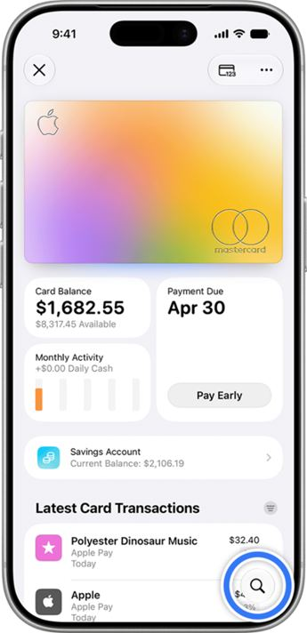
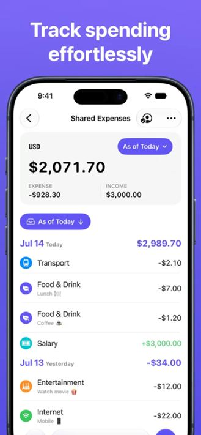
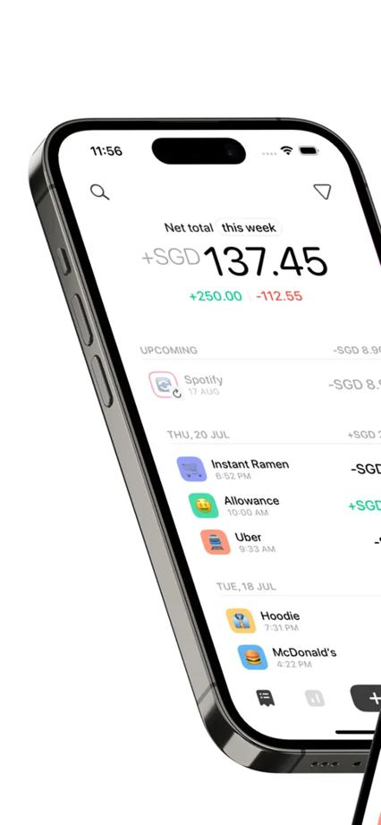
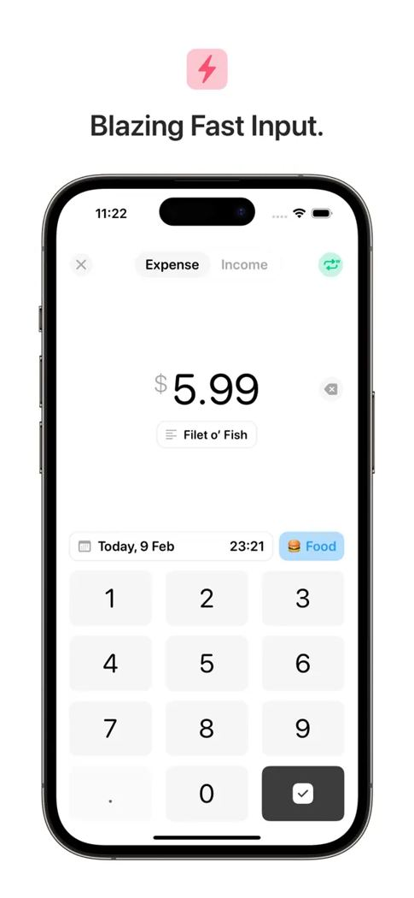
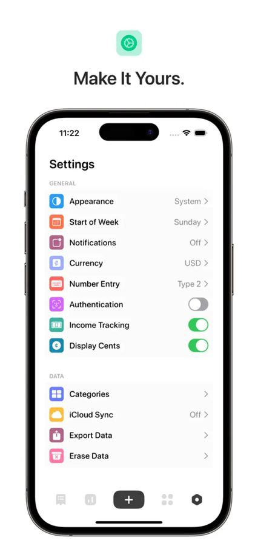

# Blubby moodboard — mobile and minimalist

User-requested direction: attractive, minimalist mobile references close to Apple's visual language. Wise was retained; other earlier references were rejected as a visual direction and moved to `archive/initial-selection/`.

## Direction

Clear interfaces, typographic hierarchy, prominent numbers, generous spacing, soft surfaces, restrained grouping, and recognizable actions. Preserve the ocean palette, Manrope, and Lucide; draw from iOS visual language without replacing Blubby's identity. Transparency or glass effects are not required.

Wise is the confirmed reference. Apple Wallet, Dime, and Expenses are newly selected visual candidates, still subject to user preference. Store screenshots may include frames and promotional copy: the reference is the interface inside the phone.

## Application to the MVP

- Monthly planning: explicit balance and period, with few information levels.
- Transactions: mobile lists with readable names, amounts, dates, and states.
- Entry: a flow focused on the amount, retaining required fields.
- Navigation and settings: simple grouping and recognizable controls.
- Forecast, completed, and canceled states remain explicit; appearance does not redefine financial rules.

Scope and open decisions remain in [mvp.md](../../../mvp.md). No final screens were created as part of this moodboard.

## References

### 01. Wise — mobile components

Credits: Wise / Ness Grixti / Ragged Edge. Reference retained by the user.

[Product source](https://nessgrixti.com/) · [Original image](https://nessgrixti.com/assets/images/portfolio/wise-refresh/refresh-results-product.png)

Apply: the already approved reference shows a brand applied to light surfaces, amounts, and mobile components with breathing room.

Avoid: copying the green palette, typography, or currency exchange features.

### 02. Apple Wallet — balance and transactions

Credits: Apple. New candidate in the revised visual selection.

[Product source](https://support.apple.com/en-us/102329) · [Original image](https://cdsassets.apple.com/live/7WUAS350/images/apple-pay/ios-27-iphone-17-pro-wallet-apple-card-search.png)

Apply: balance hierarchy, rounded blocks, soft background, and a grouped list. A direct reference for Apple's visual language.

Avoid: importing connected bank cards, limits, available credit, or payment rules.

### 03. Expenses — iPhone summary and list

Credits: Blue Comet Labs / Expenses. New candidate in the revised visual selection.

[Product source](https://apps.apple.com/us/app/expenses-spending-tracker/id1492055171) · [Original image](https://is1-ssl.mzstatic.com/image/thumb/PurpleSource221/v4/19/cd/80/19cd803d-3c1a-0bf3-1280-a941be860657/English__U0028United_States_U0029__U005ben-US_U005d_-_iPhone_-_6.9_U0022_Display_-_1.jpeg/600x1300bb.webp)

Apply: a readable main amount, breakdown of inflows and outflows, and records grouped by day. Use the phone interface as the reference.

Avoid: copying purple, promotional framing, sharing, or the other product's rules.

### 04. Dime — overview and spacing

Credits: Rafael Soh / Dime. New candidate in the revised visual selection.

[Product source](https://apps.apple.com/us/app/dime-budget-expense-tracker/id1635280255) · [Original image](https://is1-ssl.mzstatic.com/image/thumb/PurpleSource126/v4/48/05/23/48052319-f764-0880-2884-e2fe143ca2d2/fe23ba66-6b05-44b8-a8d9-2bb8d5f59df1_App_Store.png/600x1300bb.webp)

Apply: a prominent number, little ornamentation, small icons, and generous list spacing.

Avoid: copying typography or weekly indicators, or limiting Blubby to Dime's features.

### 05. Dime — entering an amount

Credits: Rafael Soh / Dime. New candidate in the revised visual selection.

[Product source](https://apps.apple.com/us/app/dime-budget-expense-tracker/id1635280255) · [Original image](https://is1-ssl.mzstatic.com/image/thumb/Purple126/v4/ea/b9/c5/eab9c55b-5ae1-28c3-89a4-049ee1fa931e/7e9a9a7e-4901-4d4a-ab4b-240bdbc0125e_App_Store_3.png/600x1300bb.webp)

Apply: focused entry with a central amount, restrained actions, and supporting information near the keyboard.

Avoid: omitting required MVP fields or assuming keyboard behavior or validation has been defined.

### 06. Dime — lists and settings

Credits: Rafael Soh / Dime. New candidate in the revised visual selection.

[Product source](https://apps.apple.com/us/app/dime-budget-expense-tracker/id1635280255) · [Original image](https://is1-ssl.mzstatic.com/image/thumb/Purple126/v4/7f/04/8e/7f048e40-fee0-055b-e9d9-ed1b49fd660e/20f7cd39-17b8-4afa-9212-183f74eeb7d1_App_Store_6.png/600x1300bb.webp)

Apply: clear groups, consistent alignment, short labels, and recognizable iPhone controls.

Avoid: copying every option; notifications, widgets, and other features do not become part of the MVP.

## Files and verification

Original files are preserved, with dimensions and SHA-256 hashes in `sources.json`. The `*-preview.jpg` copies were reduced for Figma. Images belong to their respective owners and serve only as analysis references. Blubby's legibility and interaction have not yet been tested on devices.
