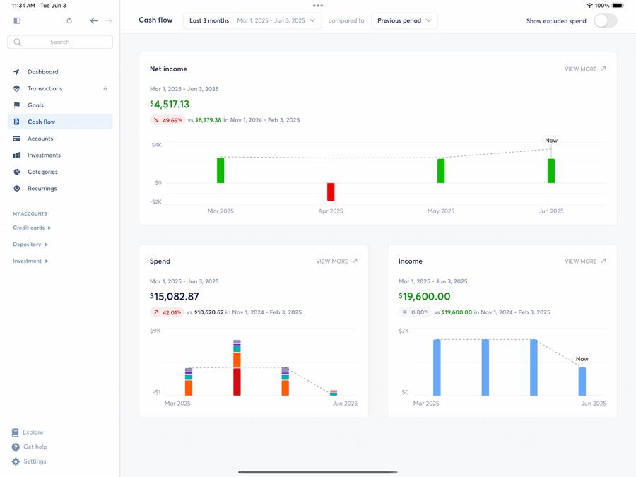
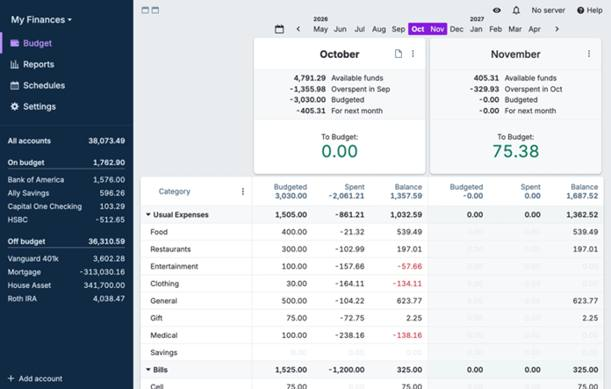
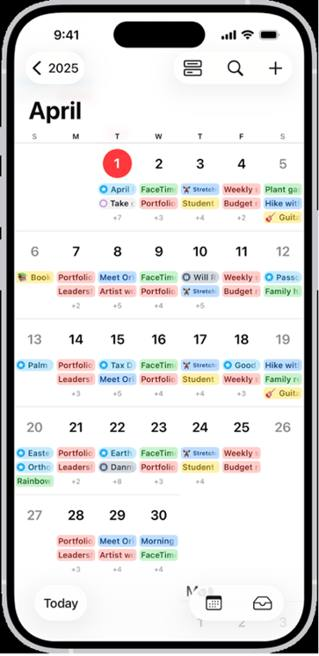
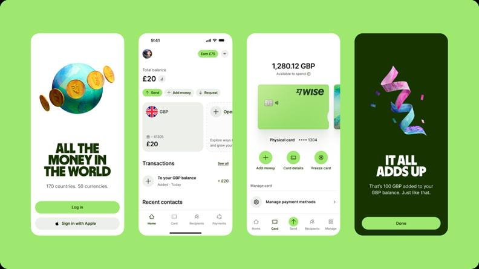
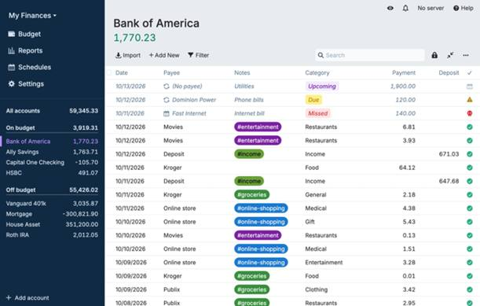
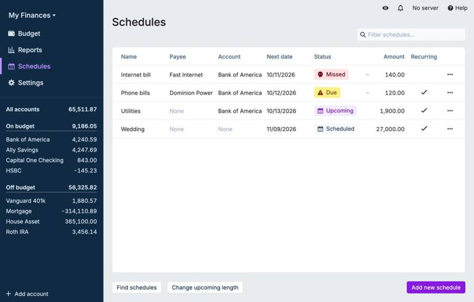
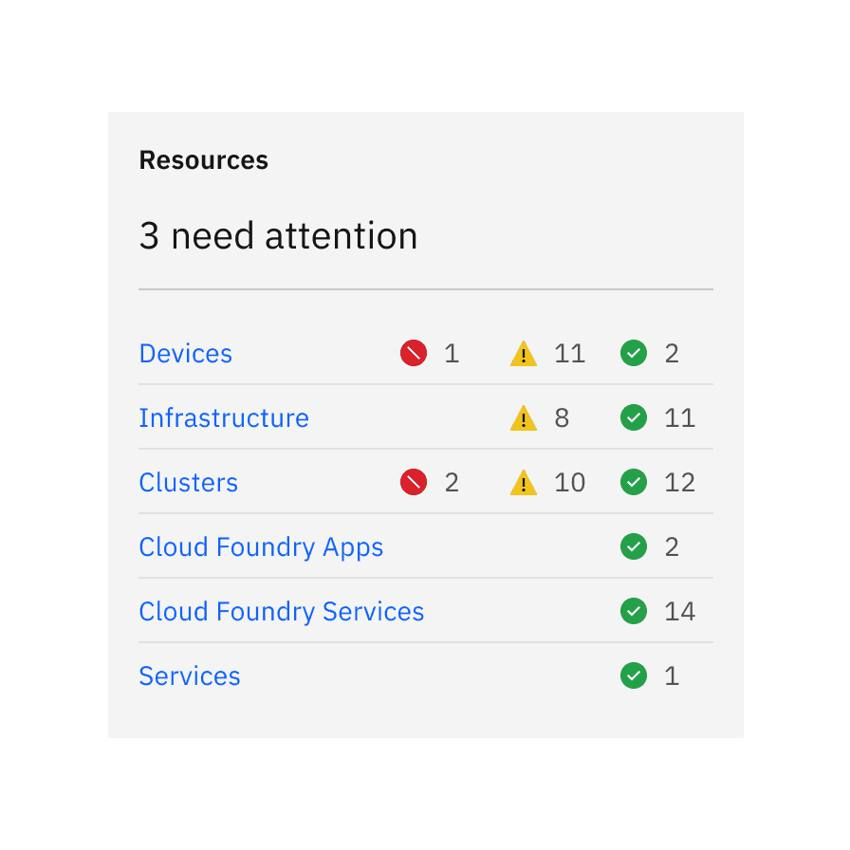
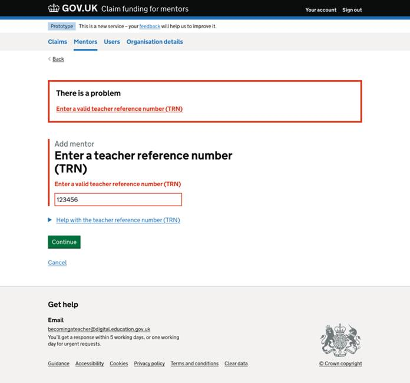

> Archived earlier selection. The user rejected these references as a visual direction, except Wise, which remains in the current selection.

# Blubby moodboard

References supplied by the user and recorded on 2026-10-20. Images serve visual analysis; they are not app assets. Attribution follows the supplied material. Image rights remain with their owners.

## Visual direction

Statement-like readability with the warmth of a personal product: clear amount hierarchy, explicit periods, calm surfaces, and purposeful color. Preserve the ocean palette, Manrope, and Lucide outline. Cyan identifies forecasts, mint identifies income, and coral communicates errors, with text and shape alongside color.

## Principles

1. Every amount needs a name, period, and distinction between forecast and completed.
2. Each month must be understandable on its own.
3. Lists keep predictable positions for name, amount, date, and state.
4. Color follows meaning; transfers and adjustments remain neutral.
5. Messages explain consequences, distinguishing cancellation of one occurrence from ending a recurrence.

Avoid excessive charts and cards, information obscured by low contrast, and importing reference-product features. Scope remains in [mvp.md](../../../../../mvp.md).

## References

### 01. Copilot Money — Cash Flow

Group: A. Financial clarity and hierarchy. Author/credits: Copilot Money / Apple Developer.

[Original image](https://developer.apple.com/articles/images/article-copilot-money_2x.jpg) · Original file: `copilot-cash-flow.jpg`.

Apply to Blubby: month, balance, breakdown, then transactions. Every amount needs an explicit period.

Avoid: importing excessive charts, banking integration, AI, or projection formulas.

### 02. Actual Budget — monthly overview

Group: A. Financial clarity and hierarchy. Author/credits: Actual Budget.

[Original image](https://actualbudget.org/assets/images/tour-budget-overview%402x-4fd3965f33841ca721be84524abf0e7d.webp) · Original file: `actual-monthly-budget.webp`.

Apply to Blubby: keep indicator name, amount, and period close together. Each month must be understandable on its own.

Avoid: importing desktop tables, envelope budgeting, or category limits.

### 03. iPhone Calendar

Group: A. Financial clarity and hierarchy. Author/credits: Apple.

[Original image](https://help.apple.com/assets/698A7AD229958FFB710D1B08/698A7AD58D2FBCE53F04F687/fi_FI/7a167465221d4c1893db79e08a8dbb49.png) · Original file: `apple-calendar.png`.

Apply to Blubby: distinguish the selected month, year, occurrence date, and today.

Avoid: requiring a calendar grid as the home screen; the screenshot is in Finnish.

### 04. Monzo — color palette

Group: B. Personality, colors, and shapes. Author/credits: Monzo / Ragged Edge (historical reference).

[Original image](https://images.ctfassets.net/ro61k101ee59/2tC9UhNTZSik3psKrMGOP7/b87adced265de2a836ecc02bf0842bac/Blog_Content_colour.jpg?q=75&w=2400) · Original file: `monzo-colour.jpg`.

Apply to Blubby: give brand color and neutrals distinct roles; concentrate intensity where it guides users.

Avoid: copying coral as the signature color, typography, or illustrations. Preserve Blubby's semantic colors.

### 05. Wise — mobile components

Group: B. Personality, colors, and shapes. Author/credits: Wise / Ness Grixti / Ragged Edge.

[Original image](https://nessgrixti.com/assets/images/portfolio/wise-refresh/refresh-results-product.png) · Original file: `wise-mobile-components.png`.

Apply to Blubby: create coherence through typography, radii, spacing, and icons, retaining neutral reading areas.

Avoid: copying green, typography, currency exchange, navigation, or celebrations after every entry.

### 06. Actual Budget — transactions

Group: C. Components, lists, and states. Author/credits: Actual Budget.

[Original image](https://actualbudget.org/assets/images/tour-accounts-register%402x-e2af97a7adbfc518ee983bf44b8da1d6.webp) · Original file: `actual-transactions.webp`.

Apply to Blubby: repeat the anatomy of name and amount, supported by date, account/card, and state.

Avoid: importing desktop columns, hover controls, bulk selection, import, or reconciliation.

### 07. Actual Budget — occurrences and states

Group: C. Components, lists, and states. Author/credits: Actual Budget.

[Original image](https://actualbudget.org/assets/images/tour-schedules-overview%402x-71787fdad8ffeac33a33e2c774836383.webp) · Original file: `actual-scheduled-occurrences.webp`.

Apply to Blubby: keep written state labels near the occurrence. Canceled records remain legible and available for review.

Avoid: adopting the reference product's rules, states, or automation as Blubby rules.

The supplied link returned HTTP 404; it was replaced with the schedules overview from the official documentation.
[Official page](https://actualbudget.org/docs/tour/schedules/) · [Supplied link, unavailable](https://actualbudget.org/assets/images/schedules-from-transactions-link-schedule-0c497579920c773065413fa2650bfb5c.webp).

### 08. Carbon — state alignment

Group: C. Components, lists, and states. Author/credits: IBM / Carbon Design System.

[Original image](https://s3.us-south.cloud-object-storage.appdomain.cloud/cxp-prod-payload-cms/status-alignment-do.png) · Original file: `carbon-status-alignment.png`.

Apply to Blubby: keep icons and labels in stable positions; combine shape and text with color.

Avoid: importing Carbon icons or treating expenses as severity levels.

### 09. Department for Education — form error

Group: D. Tone of voice and user guidance. Author/credits: Department for Education / Claim funding for mentors.

[Original image](https://becoming-a-teacher.design-history.education.gov.uk/claim-funding-for-mentors/adding-mentors/mentors--add-mentor-error-message-invalid-trn.png) · Original file: `dfe-form-error.png`.

Apply to Blubby: explain corrections near the field and preserve input.

Avoid: copying the government layout or that form's validation rules.

### 10. Department for Education — confirmation

Group: D. Tone of voice and user guidance. Author/credits: Department for Education / Manage training.

[Original image](https://teacher-cpd.design-history.education.gov.uk/manage-training/school-choosing-an-induction-programme/05-induction-programme-confirmed-noects.png) · Original file: `dfe-confirmation.png`.

Apply to Blubby: confirm the action's effect and explain what happens next.

Avoid: creating a full page or large green panel for every entry. Match feedback to consequences.

## Files and verification

`sources.json` records original URLs, dimensions, and SHA-256 hashes. The `*-preview.jpg` files are reduced copies for the Figma board; originals are preserved.

These references do not validate financial rules, projection calculations, or screen behavior. At the time of this archived selection, billing cycles, first bills, projection horizon, and store lookups remained pending under the MVP. No final screens or AI-generated images were created.
