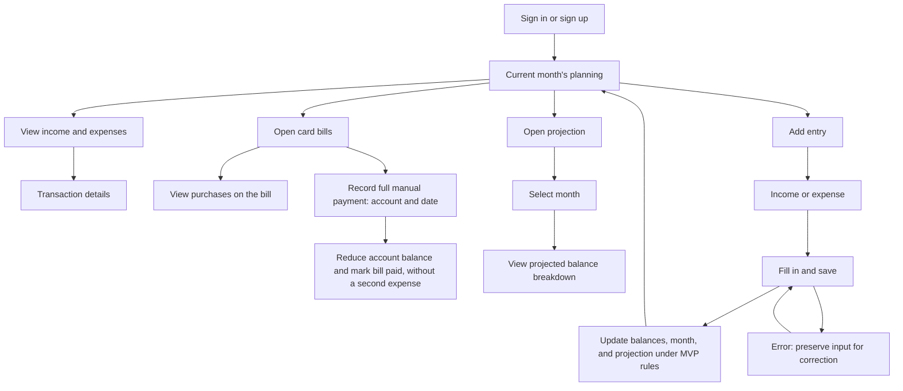

# Monthly planning flow

This document records the approved monthly planning flow and initial hierarchy, following the financial rules in the [MVP](../../mvp.md). It does not define implementation or the final visual layout of the screens.

## Entry and first use

After signing in or signing up, the user opens the current month's planning directly. On first use, guidance to add the first account or wallet appears in that context, without a mandatory setup wizard before planning. The initial balance follows the MVP rule: it is a starting point, not income or an expense.

## Viewing and recording

Transaction details show the corresponding record. Card bill payment is manual and in full, with the source account and date provided by the user; it does not create a second expense.

The projection covers the current month and the next 12 months. Each month shows its projected closing balance. Selecting a month shows the balance carried over from the previous month, expected income, expected expenses in accounts and wallets, and expected card bills. For the current month, the calculation starts from the current consolidated balance, as defined in the MVP.

The presentation states "Projeção baseada nos seus registros" and explains that unrecorded amounts are not included. The formula is not the main content.

Saving income or an expense updates balances, the month, and the projection according to the entry type and status. Expected transactions are not treated as completed; card purchases do not reduce the account balance before the bill is paid. Errors preserve input for correction.

## Initial main screen hierarchy

The accepted starting point for reading the planning screen is:

1. Selected month.
2. Prominent current balance.
3. Expected month-end balance in a secondary position.
4. Income, expenses, and card bills.
5. Recent transactions and the add-entry action.

This hierarchy is provisional and may change after reviewing the first design, while preserving the approved financial rules.

## First wireframe

The [first wireframe in Figma](https://www.figma.com/design/QYrBUue2AdyrjvJLiMu7F2/blubby?node-id=75-2) is on page 05 — Telas do MVP, section 05.03 — Planejamento mensal. It applies the accepted initial hierarchy in two 393 × 852 states: a month with records and first use.

The amounts are fictional and distinguish monthly totals from amounts still pending:

- Current balance: R$ 4.280; income still expected: R$ 1.000; expenses still expected in accounts and wallets: R$ 650; card bills still payable: R$ 1.800. The expected balance is R$ 2.830: R$ 4.280 + R$ 1.000 − R$ 650 − R$ 1.800.
- Monthly totals: income of R$ 6.000, account expenses of R$ 1.450, and card bills of R$ 1.800. The details distinguish the pending amounts used in the projection.

The wireframe is static, with destinations not yet connected and global navigation still pending. It needs user review; it is not approved as the final design and has not been tested on a device.

## Alternative B — navigation test

The [alternative B in Figma](https://www.figma.com/design/QYrBUue2AdyrjvJLiMu7F2/blubby?node-id=83-99) tests a tab bar based on the [bank references](../../assets/references/navigation-banks/README.md). The original wireframe (`75:2`) is preserved above the alternative. This test does not approve the final navigation.

There are two 393 × 852 states: a month with records (`83:105`) and first use (`83:142`). The proposal groups "Planejamento" (month and projection), "Lançamentos" (income and expenses), "Contas" (accounts, wallets, and cards), and "Ajustes" (settings). Tabs combine an icon and a name, with an indicator and color for the active tab and a 98,25 × 64 touch target. The fixed add action remains separate, rather than becoming a fifth tab.

The visible content area changes from 706 to 638 units, with the list in a scrollable area. Financial data and rules remain unchanged. The alternative is static, with destinations not connected and no usability or device testing.

## Open decisions

- Define the app's global navigation; alternative B is under review.
- Review the initial wireframe with the user, including visual layout and hierarchy.
- Financial exceptions and validations not yet approved, including canceling an occurrence after its card bill has been paid and other details of the billing cycle.
